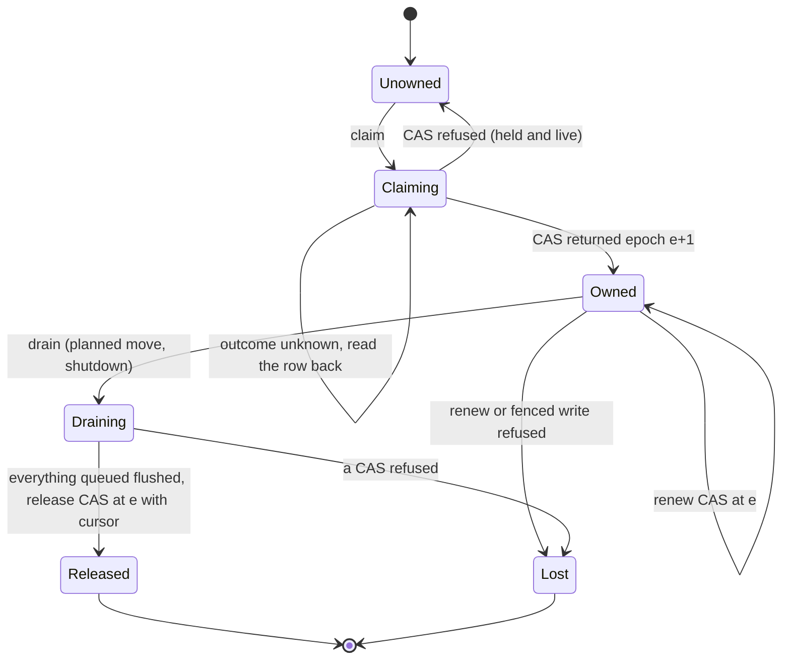

# Concurrency

Nanocode has to stay correct under heavy load by design, not because callers are careful. Every piece of shared state belongs to exactly one owner. Ownership is a lease with an epoch. Every durable write is a compare-and-set against that epoch or a revision. Nothing waits on a lock: a contended write either lands or is refused, and the refusal has a type.

This file holds the rules, the invariants the simulator checks, the ownership model, and the map of everything that still breaks a rule, with its replacement. An entry leaves the map when the commit that removes it lands.

## Rules

1. **One writer per scope per epoch.** A scope is a thread's log, a board, a log partition, a durable state or a workspace head. At most one owner holds a scope at a given epoch, and only that owner's writes at that epoch can land.
2. **No lost acknowledged writes.** An append that returned `Ok` is durable and stays visible to every later owner. A handoff carries the committed position forward. It never re-derives it.
3. **No lock across `.await` or the network.** In process there is no `Mutex`, `RwLock`, `Condvar`, `Owned`/`Held`/`Leased` guard, `Semaphore::new(1)`, `OnceCell` initializer or `Sequencer` turn held across a suspension point. In the database there are no advisory locks (session or transaction), no `FOR UPDATE`/`FOR SHARE`/`FOR KEY SHARE`, and no no-op `UPDATE` or upsert used as a mutex. The only row locks are the ones Postgres takes for the single compare-and-set statement itself, inside a pipelined transaction that never waits on the client.
4. **No DDL on open.** Schema changes run in a one-shot `migrate` step before anything serves. Opening a store reads the stored format version once per process and returns `SchemaBehind` if it's old. It never creates, alters or indexes anything.
5. **Liveness is lease expiry, judged on the database clock.** A dropped connection, proxy cut or failover is a transport event. It doesn't mean ownership is lost. Ownership is lost only when a fenced write or a renewal compare-and-set says the epoch moved. Membership heartbeats may rank who claims next. They never authorize taking a lease.
6. **Every wait has a deadline.** Pool checkout, connect, `lock_timeout`, `statement_timeout` and `idle_in_transaction_session_timeout` are set for every transaction class. When a deadline passes, the caller gets a typed refusal (`Busy`, `Lost`, `SchemaBehind`), never a hang.
7. **Capacity is not ownership.** A `Semaphore` bounds resources (CPU, memory, connections), and its permit is acquired with a deadline. It never serializes access to state.

## Invariants

Each invariant has a check in `bin/nanocode-sim` and a mutation that breaks it. The sweep must turn red for each mutation (`bin/nanocode-sim/cfo.sh` runs them as canaries). "To add" marks a check the simulator doesn't make yet. It lands with its mutation, in the commit that removes the map entries it covers.

| Invariant | Sim check | Mutation |
|---|---|---|
| **I1** Exactly one writer per scope per epoch | `--scenario partitions` invariant 1 (one holder per epoch, epochs never go back) | `claim_keeps_epoch`, `double_claim` |
| **I2** No lost acknowledged writes | `--scenario plog` (every acked row is read back by the next owner); `--scenario partitions` invariant 3 (no replay, one result) | `partial`, `overwrite`, `lost_ack_rejected`, `replays_in_flight`; to add: `release_drops_cursor`, `drain_refuses_queued` |
| **I3** No lock held across `.await` or the network | To add: a stalled store or model call on one scope must not delay any other scope's step | To add: `held_across_await` (an owner keeps its turn across a store call) |
| **I4** A claim never takes a live lease | To add: no claim lands on a row that is held by another node, not `Released`, and has `expires_at + grace >= now` on the database clock | To add: `steals_live` (claim on a stale membership view), `skips_grace` |
| **I5** A `Lost` epoch never writes again | `--scenario partitions` invariant 2 (fenced appends); `--scenario plog` fence check | `unfenced` (both scenarios); to add: `renew_ignores_epoch` |
| **I6** Every wait has a deadline and a typed refusal | To add: with a store that never answers, every caller returns `Busy` or `Lost` within its deadline | To add: `waits_unbounded` (pool acquire or connect without a deadline) |

The simulator models the lease row, owners, the network and the database clock. It drives every transition, injects a crash after every step (before and after each CAS lands, between flush and release), and plays stale-epoch writes after every handoff. Under real load, the measurement is: no lock waits (sampled `wait_event_type = 'Lock'` and `pg_locks WHERE NOT granted`), no statement timeouts, throughput that grows with the number of owners, and handoff stall time.

## Ownership: the lease state machine

Each scope has a lease. In process, its state is one enum, and each variant carries only what that phase has:

```text
Unowned
Claiming { attempt }                     claim CAS in flight; its outcome may be unknown
Owned    { epoch, expires_at, cursor }   the only state that may write
Draining { epoch, expires_at, cursor }   admits nothing new; keeps its epoch while it flushes
Released { epoch, cursor }               handed back at a known cursor; claimable at once
Lost     { epoch, by }                   a CAS said the epoch moved; terminal for this epoch
```



Transitions are typed functions from one variant to another, driven only by compare-and-set answers and the clock. The answer to an ambiguous claim (timed out, outcome unknown) is read back from the row before anything is decided. It is never assumed.

The lease row (it generalizes `nanocode_log_fence` and `nanocode_partitions::Row`):

```sql
scope      TEXT PRIMARY KEY
epoch      BIGINT NOT NULL      -- rises on every claim, never reused
holder     TEXT                 -- node id and address; NULL when Released
expires_at BIGINT NOT NULL      -- database clock, ms
cursor     BIGINT NOT NULL      -- last committed position, set on release
```

Neither `nanocode_log_fence` nor `Row::Free` has a `cursor` column today. Adding it is a format bump through `migrate`.

- **Claim** (`Unowned → Claiming → Owned`): `UPDATE … SET epoch = epoch + 1, holder = $me, expires_at = now + ttl WHERE scope = $1 AND (holder IS NULL OR holder = $me OR expires_at + grace < now) RETURNING epoch, cursor`. A claim lands only when the row is `Released`, already held by the claimer, or expired past `grace` on the database clock. Nothing else authorizes it: membership liveness (heartbeats, a peer list, `pg_locks`) may rank which node should claim next, but never lets a node take a lease whose `expires_at + grace` is still ahead. `grace` is at least the longest transaction any owner can run (`statement_timeout`), so a stale owner's last in-flight write has committed or failed before anyone claims an expired lease.
- **Renew** (`Owned → Owned`): `UPDATE … SET expires_at = now + ttl WHERE scope = $1 AND epoch = $e AND holder = $me`. Zero rows means `Lost`. Renewals are batched per node, one statement for all of its scopes. A renewal touches only the lease row, so it never waits behind a commit.
- **Fenced write**: every write transaction is one pipelined batch, and its first statement is a compare-and-set on the scope's head that checks the epoch: `UPDATE head SET pos = $p WHERE scope = $1 AND epoch = $e RETURNING pos`, or the log's own `PRIMARY KEY (scope, seq)` collision. Zero rows means `Lost`. With one owner per scope there is never a second writer queued on the head, so a claim waits for at most the one commit in flight.
- **Position semantics**: the head CAS fences on the epoch. It doesn't change what `pos` means. On Postgres, `pos` comes from one global sequence (`nanocode_log_pos`) shared by every partition; on SQLite it is `MAX(pos) + 1` per partition. `$p` is the batch's last position from that same source. Making `pos` a per-partition counter is a format bump through `migrate`, after checking every `follow()` and cursor user that compares positions across partitions.
- **Drain and release** (`Owned → Draining → Released`): stop admitting new work, but keep the epoch. Everything queued before the drain (the commit in flight and every append behind it) flushes at that epoch and gets its answer. Then `UPDATE … SET holder = NULL, cursor = $c WHERE scope = $1 AND epoch = $e`. The gainer claims a `Released` row at once: no TTL wait, and no full re-read, because it resumes from the snapshot at or before `cursor`.
- **Owner self-fence**: an owner stops issuing writes when its local deadline (`expires_at - margin`) passes without a renewal landing. It doesn't wait to be told.
- **Gain**: each gained partition recovers in its own task, from the snapshot at or before its `cursor`, and starts serving as soon as it has recovered, not when the whole node is ready. A capacity `Semaphore` (rule 7) bounds how many recover at once. No ordering lock serializes them, so catch-up time follows the largest backlog, not the partition count.

### Scaling out

A request can land on any replica, and replicas are stateless. The replica computes `partition_of(scope)`, reads the partition's lease row, and forwards the request to the `holder` address, or serves it in process when it is the holder. A replica that finds no live owner claims the partition. The owner runs one task (a `Mailbox`/`Actor`) per live scope, holds the scope's state by value, and publishes an `Atom<Arc<Snapshot>>` after each commit for reads. Replicas share no locks and need no coordination code, and partitions don't contend, so adding owners adds throughput. A handoff is an epoch bump: the old owner drains and releases, the new one claims at `epoch + 1`, and any write the old owner still sends is refused as `Lost`.

### Schema

- `migrate(sql) -> Migrated` is the only function that runs DDL. It runs as a one-shot step at deploy time, never from `open`, `prepare`, `claim` or a request. One runner holds a migration lease row, so racing nodes don't build the same thing twice.
- Every DDL statement runs with `lock_timeout` and a bounded retry, so a migration waiting for its lock never sits in the lock queue in front of live traffic.
- Indexes are built `CONCURRENTLY`. That can't run inside a transaction, and store-sql's `SqlAccess::Schema` wraps every batch in `BEGIN`/`COMMIT`. So `migrate` needs a non-transactional access (one autocommit statement per call). After the build it checks `pg_index.indisvalid`, drops and rebuilds an invalid index, and records the format only once the index is valid.
- Every store constructor takes `&Migrated`, so code that hasn't migrated can't open a store. `Migrated` is built either by `migrate` or by `Migrated::check(sql)`, which is one `SELECT` of `nanocode_formats`. `check` returns `SchemaBehind` when a format is old, and its result is cached for the whole process.
- A data conversion (a table copy or type change) is an expand step, then a batched background backfill owned by a lease, then a contract step. It never runs inside a request.

## The map: what still breaks a rule

Locations are paths at master. "Rule" is the rule broken. "Replacement" is what removes the entry.

### Database locks and fences

| Entry | Location | Why it exists | Failure under load | Rule | Replacement |
|---|---|---|---|---|---|
| Parted fence row lock | `crates/core/turnlog/src/parted/sql.rs` `LOCK`, used by `fenced()` | A claim's fence swap can't commit between a commit's epoch check and its insert, and positions follow commit order | Every commit, compaction and prune of a partition queues on one row for the whole transaction, including the WAL flush. Claim and renew swaps wait behind commits, so leases lapse under write load | 3 | One owner per partition does group commit, so there's one committer. The head CAS on epoch is the first statement. Renewals move to the lease row. Drop `LOCK` |
| Unfenced parted log | `parted/sql.rs` token `-1` (`$2 < 0` in `LOCK`/`INSERT`/`DROP`/`PRUNE`); `bin/nc-board/src/cli.rs` `PartedLog::new` with one partition | Lets a host write without claiming a partition | Every write skips the epoch check but still row-locks fence row 0, so every board writer serializes on one row per commit. Once the advisory hold is gone, two writers of one actor are kept apart only by the `(part, scope, seq)` key, and nothing fences compaction or prune | 1, 3 | Delete the `-1` mode. The board is a scope with one owner reached by forwarding, or keyed writes whose seq CAS is the only fence, with `LOCK` replaced by the head CAS |
| Parted lease on the node clock | `parted/mod.rs` `claim`/`renew`/`release`, `crates/core/partitions/src/lib.rs` `Row` | Partition ownership by full-row CAS | `expires_ms` comes from each node's own clock, so clock skew shortens or stretches leases. There is no `grace` (claimable at `expires_at <= now`) | 5 | The lease row above on database time, with `grace` |
| Early steal on membership | `crates/core/partitions/src/lib.rs` `Row::claimable` (`!holder_live`), `live` by `seen_at` on the caller's clock | Moves a partition off a node that looks dead before its lease expires | A membership flap, GC pause or slow heartbeat lets a peer claim a lease whose `expires_at` is still ahead. The holder is fenced and the gainer runs a full re-recover | 5 (I4) | Claim only when `Released`, held by self, or `expires_at + grace < now` on the database clock. Liveness only ranks claimers |
| Drain refuses queued appends | `parted/mod.rs` `release` (removes `held` before `drain()`), `committed` | Stops writes once a release starts | Appends queued behind the in-flight commit are refused as `Fenced`, so callers see a planned move as `Lost` | 2 | `Draining` keeps the epoch, flushes everything queued, then CASes release with the cursor |
| Release has no cursor | `crates/core/partitions/src/lib.rs` `Row::Free { epoch }`, `parted/sql.rs` `nanocode_log_fence` | — | A gainer can't resume from a cursor, so every move re-reads the whole partition | 2 | A `cursor` column on the lease row (format bump), set by the release CAS, and a snapshot-at-cursor contract |
| Parted prepare re-creates partitions | `parted/sql.rs` `PARTS` through `migrate_format_then` | Creates `LIST` partitions and fence rows | In the steady state it costs one plpgsql round trip and N no-op inserts on the write pool, because Postgres skips `CREATE TABLE IF NOT EXISTS` on an existing name before locking the parent. On a fresh database, or when the partition count rises, each new partition takes `AccessExclusive` on `nanocode_plog` and blocks appends on every partition, with no `lock_timeout`, from every node at once | 4 | Partition count is part of the format and is created only by `migrate`, with `lock_timeout` and retry |
| Retention pinned by dead cursors | `parted/sql.rs` `DROP`/`PRUNE`/`INSERT_COMPACTING` `min(pos)` over `nanocode_log_cursor` | Never delete rows that a reader hasn't consumed | One dead reader stops retention for its partition, so the table and scans grow without bound | 5 | Cursors are leases with an expiry, and retention ignores expired cursors |
| `NOTIFY` fallback in the commit | `parted/sql.rs` `INSERT`/`INSERT_COMPACTING` (`$4 = 1`); outbox `NOTIFY_PG` and `notifier()` | Wakes followers on other nodes | Commits hand heads to an outbox notifier that sends `NOTIFY` in its own transaction, which still takes Postgres's cluster-wide notify lock. A host that doesn't drive `notifier()` falls back to `NOTIFY` inside every commit. A listener that stops reading fills the queue | 3 | Followers read each partition's committed `pos`. At most one coalesced notify per partition per interval, outside the commit, and no inline path |
| Owner `FOR SHARE` | `crates/core/durability/src/sql.rs` `INSERT_RECORDS`, `HOLD`, `GROUP_HOLDS_PG`, `GROUP_REPLACE_PG`, `REPLACE` | An acquire's fence bump can't land between a write's fence check and the write | Many writers share-lock the same owner row, which creates MultiXacts, SLRU contention and early anti-wraparound vacuums. Acquire waits for every sharer | 3 | Fence and revision on the state row itself, with one CAS `UPDATE … WHERE revision = $r AND fence = $f` (what `RowStore` does) |
| Records `FOR KEY SHARE` | `durability/src/sql.rs` `GROUP_LOCK_RECORDS_PG` | `collect` can't delete a record a commit is about to reference | Hot records get MultiXacts. `collect`'s `FOR UPDATE` waits on all of them, and new commits wait behind `collect` | 3 | Records are immutable. GC is mark-and-sweep with a grace period, so references are inserted without locks |
| `collect` row-lock mutex | `durability/src/sql.rs` `HOLD_OWNER` (a no-op upsert), `LOCK_RECORDS`, `FENCE` | Serializes GC against writers and acquire | It takes owner then records, while group commit takes records then owner: a deadlock. It also bumps a live owner's fence | 3 | Only the scope's owner collects its own state, at its epoch. GC never fences another owner |
| Acquire always steals | `durability/src/sql.rs` `ACQUIRE`, `durability/src/row.rs` `acquire`, `durability/src/kv.rs` CAS loop | The newest acquirer wins and fences the previous owner | Two runtimes that both think they own a state fence each other in turn (livelock). Every steal forces a full reload | 1 | The claim CAS above: steal only when `Released` or expired past `grace` |
| Compaction fences the owner | `durability/src/row.rs` `COLLECTED` (`fence = fence + 1`) | Owner writes can't target the layout from before compaction | A sweep during traffic fences the hottest states, causing a wave of `Fenced` errors and reloads | 1 | Compaction is an owner operation at its epoch |
| Shared blob refcount row | `crates/core/workspace-fs/src/sql.rs` `ADD_BLOB`, `RELEASE_BLOBS`, `RELEASE_EARLY` | Content-addressed blobs are shared across workspaces | One popular blob row is updated by every workspace | 3 | A `(workspace, digest)` reference row per workspace, with mark-and-sweep |
| Session log guard by division error | `crates/runtime/agent/src/session_log.rs` `CHECK_TAIL` (`1 / count(*)`), `APPEND_TAIL` | Two writers of one session log can't interleave | Contention shows up as aborted transactions, then a stale reload (three queries), then a retry | 1 | The session log is a scope with a lease. Appends CAS on epoch, and zero rows means `Lost` |
| `nc-board` actor hold | `bin/nc-board/src/cli.rs` `HOLD`/`UNHOLD` (`pg_advisory_lock`), `advise`, `locked` | One actor's writes from parallel CLI calls don't race | Blocks with no timeout while pinning the pool's single connection. It is a session lock taken in a pooled transaction: if that connection reconnects between `HOLD` and `UNHOLD`, the lock is gone mid-work, another CLI's `HOLD` succeeds, and `UNHOLD`'s `false` is dropped. A killed CLI behind a pooling proxy keeps the lock | 3, 5 | Keyed writes (`Board::submit_keyed`) and the log's seq CAS. Being removed |
| `nc-board` file lock | `bin/nc-board/src/cli.rs` `open(dir)` `board.lock` | Same as above, for the directory store | A blocking `flock` with no timeout | 6 | The `FileLog` seq check |
| Board task leases on the writer's clock | `crates/core/board-fold/src/lib.rs` `claimable` and `tasks.rs` (`now_ms.max(at_ms)`) | Task claims lapse in the fold | `at_ms` comes from the writer. One writer with a fast clock pushes the fold's `now_ms` forward and lapses everyone's task leases early, causing takeovers | 5 | Stamp `at_ms` from the log's commit time at append, or have the owner bound how far `at_ms` may run ahead |
| `mpp` file lock | `crates/integrations/mpp/src/store.rs` `lock_file` (`StoreLease::File`) | Cross-process exclusion per payment key | A process stalled mid-payment holds the `flock`, and every other process's payment for that key blocks a thread with no deadline | 3, 6 | A nonce or cumulative-amount CAS in the store, a reservation row with epoch and expiry, and no file lock |
| Session lock framework | `crates/core/sync/src/session.rs` `SessionLocks`, `SessionLock`, `Locker` | Hands out connection-bound locks with a keepalive | Each held lock pins a connection, so N holders exhaust the pool. The lock vanishes on failover (see "Handoff" below) | 3, 5 | Delete it, with `Lines`. Nothing outside `crates/core/sync` uses it. Being removed |
| No timeouts | `crates/integrations/store-sql/src/postgres/{pool,sql,connection}.rs` | — | Pool `acquire` waits forever. No `lock_timeout`, `statement_timeout` or `idle_in_transaction_session_timeout` is set, so one blocked statement holds its connection until the server gives up | 6 | Set all three per transaction class, give acquire and connect one deadline, and cancel the server statement on client timeout |
| SQLite `BEGIN IMMEDIATE` for reads | `bin/nc-lite/src/sqlite.rs` | Avoids `SQLITE_BUSY` on lock upgrade | Reads serialize with writes across processes | 3 | One owner process per file. Reads use `DEFERRED` |

### DDL on the request path

| Entry | Location | Failure | Replacement |
|---|---|---|---|
| `nanocode_formats` create per instance | `crates/core/durability/src/sql.rs` `migrate_format_then` (`CREATE_FORMATS`) | Every new `SqlLog`, `WakeIndex`, `SqlParts` and store instance issues `CREATE TABLE IF NOT EXISTS` on the write pool, and it fails on a read replica | `Migrated::check`, cached per process |
| No `lock_timeout` on any migration | `durability/src/sql.rs` `migrate_format_then`; the `DO`-block `ALTER`s in `crates/core/turnlog/src/host.rs` and `parted/sql.rs` | An `ALTER TABLE` or `CREATE INDEX` waiting for its lock sits in the queue behind one long reader, and every later append, load and autovacuum on that table queues behind it. Pools fill and timeouts cascade. Two nodes on an old format both run the whole migration, and the loser's error is hidden by re-reading the stored format | `migrate` with `lock_timeout`, bounded retry and one runner holding a migration lease |
| Turn log, wake index | `crates/core/turnlog/src/host.rs` `SqlLog::prepare`, `wake_index.rs` `WakeIndex::prepare` | The prepared flag is per instance, so a host that builds an instance per open repeats the check. After a format bump, the first open on every node runs the index build concurrently with live appends | Stores take `&Migrated` |
| Legacy durable store | `crates/core/durability/src/sql.rs` `migrate()` from `run`/`settled`/`records`, and from `RowStore::migrate` | The first request after a format bump copies and drops `records`/`blobs` under `AccessExclusive` | `migrate` only, with a batched backfill |
| Row store | `crates/core/durability/src/row.rs` `ALTER COLUMN body TYPE BYTEA`, `CONVERT` | The first request rewrites `state_pages` under `AccessExclusive` | Expand, backfill, contract |
| Session log convert | `crates/runtime/agent/src/session_log.rs` `CONVERT` via `writer()` | The first open copies `events`/`turns` into `log_*` and drops them | Background conversion with a cursor |
| Session log indexes | `session_log.rs` `INDEXES`/`ORDER`, run from `open` | The first open per instance runs `DROP INDEX` (`AccessExclusive` on `log_turns`) and a plain `CREATE INDEX` (`ShareLock`). After a format bump, the first open on each node blocks every `log_turns` read and write for the whole build | `migrate` only: `DROP`/`CREATE INDEX CONCURRENTLY` with `lock_timeout` |
| `nc-board` prepare on open | `bin/nc-board/src/cli.rs` `PREPARED` check, then `log.prepare()` | Every concurrent CLI call on a fresh database creates partitions | `nc-board migrate` |
| Hand requests | `crates/integrations/tool-runtime/src/remote/accept/requests.rs` `migrate` | Safe only while hosts call it once at start | `migrate` only |

### In-process exclusion and shared state

Each `Sequencer` holder has its own row, so each can leave the map on its own.

| Entry | Location | Failure under load | Replacement |
|---|---|---|---|
| `Owned`/`Held`/`Leased` | `crates/core/sync/src/lib.rs` | A guard can be kept across any `.await`, and `acquire` has no deadline, so every waiter queues FIFO behind a holder that is blocked on Postgres or a model call | Remove it from the public API once the rows below that use it are gone. One owning task per scope |
| `Sequencer` | `crates/core/sync/src/lib.rs` | A data-less async mutex. Paired with `Slot` it rebuilds a mutex by hand | In-process ordering only, with no `.await` while a turn is held. Otherwise the owner's `Mailbox`. Each holder below leaves on its own |
| `Lines` | `crates/core/sync/src/lib.rs` | A keyed async-mutex factory whose only user is `SessionLocks` | Delete it with `SessionLock` |
| Code Mode admission (`Sequencer`) | `crates/runtime/code-mode/src/code_mode/mod.rs` `admission` | Held across journal store I/O (`load`, `await_restore`). A slow store queues every new exec and terminate on the session, with no deadline, and terminate waits behind the admission it is trying to cancel | Admission is a message to the cell's actor. Restore runs before admission as a `Claiming` step, and `admission_epoch` stays as the fence that refuses stale cells |
| Subagent child start (`Sequencer`) | `crates/runtime/subagents/src/runtime.rs` `UnstartedChild::lock`, held in `tools.rs` | Held across the parent's `ensure_resident` (recursive), `spawn_parent` and remote `resolve_spawn` (network) | Commands to the root session's owner task |
| Subagent warm-up (`Sequencer`) | `runtime.rs` `warming`, held in `runtime/restore.rs` | Held across cold-state store loads | Warm-up is a `Claiming` step that publishes a `watch` state (`RestorationState`), and callers subscribe |
| Subagent spawn admission (`Sequencer`) | `runtime.rs` `spawn_admission` (`Atom<Map<String, Sequencer>>`) | Held across `await_restored`, so every spawn in a root waits for restore with no deadline. The registry grows per root and is never pruned | Spawns subscribe to the restore state instead of queueing |
| Subagent completion dispatch (`Sequencer`) | `runtime.rs` `completion_dispatch`, `runtime/delivery.rs` | Orders delivery by holding a turn per agent. The registry grows per agent and is never pruned | A per-agent seq on the outbox |
| Subagent residency (`Sequencer`) | `runtime.rs` `residency_lock` (`try_enter` only) | Never waits, but a parent-child residency chain can wait cyclically with `closing` | Commands to the root session's owner task |
| Subagent scope locks | `runtime.rs` `ScopeLocks`, `lifecycle.rs`, `restore.rs` | `closing` is held across harness interrupts (up to the stop timeout). The map is never pruned | Commands to the root session's owner. Long steps are spawned, and their completion is a message |
| Claude admission and persistence (`Sequencer`) | `crates/backends/claude/src/agent.rs` `admission`, `persistence_update`; `agent/context.rs` | `context.rs` takes `admission` then `persistence_update`, nested and held across persistence. A different nesting order deadlocks | The session is one owner. Persistence CASes on the boundary revision |
| Claude conversation and steering | `crates/backends/claude/src/agent.rs`, `agent/{assemble,driver,durable,rounds,keep,side}.rs` | Guards nest and are held across model streaming and persistence | The session is one owner. Steer and interrupt are messages |
| Facts order (`Sequencer`) | `crates/backends/{claude,codex}/src/durability/facts.rs` `order` | `Sequencer` plus `Slot` held across `commit_fact`. A dropped future empties the slot | Owner fold, `Atom` snapshot, expected-seq CAS |
| Claude hydrating (`Sequencer`) | `crates/backends/claude/src/durability/mod.rs` `hydrating` | One slow load blocks every other load | `SingleFlight` keyed by what is loaded |
| Row index loading (`Sequencer`) | `crates/core/durability/src/row.rs` `loading` | One slow load blocks every other load | `SingleFlight` keyed by what is loaded |
| Observability span turns (`Sequencer`) | `crates/integrations/observability/src/layer.rs` `turns` | `wait_for` blocks a thread on an async `Sequencer` inside tracing hooks | A per-span `Inbox`, or `Atom::update` |
| `Semaphore::new(1)` as a mutex | `crates/core/workspace-fs/src/fs.rs` `gate`, `crates/integrations/mpp/src/session.rs` payment and funding locks, `mpp/src/store.rs` leases | Held across store commits and payment round trips, up to the challenge's expiry, and with no deadline when the challenge has none. It protects only one process | Revision CAS on the manifest. A channel nonce or cumulative-amount CAS in the store |
| `mpp` server-spent saves | `mpp/src/session.rs` `server_spent_saves` | A process-wide `Semaphore(1)` held across a channel-store write with no deadline. Every paid response on every channel serializes on one store round trip, and across processes saves can still land out of order | A monotonic CAS: `UPDATE … SET spent = $s WHERE channel = $c AND spent < $s`. Drop the semaphore |
| `mpp` lock registries | `mpp/src/session.rs` `funding_locks`, `mpp/src/store.rs` `MemoryChannelStore` leases | Never pruned, so they grow one `Semaphore` per channel or key. Every insert clones the whole map. `MemoryChannelStore::acquire` has no deadline | The CAS above. Until then, `Weak` entries pruned on drop and acquire with a deadline |
| Turn log writer lease | `crates/core/turnlog/src/writer.rs` `Lease`, `lease`, `lease_within`; users in `crates/runtime/agent/src/one_log*` and `bin/nanocode-sim` | Held across the append round trip and read scans (fold reads and stats take it too), so one slow append stalls every reader and writer of that thread ("stayed held past") | The writer is an owning task, and reads come from a published fold snapshot. Being removed |
| `owed` flag | `crates/runtime/agent/src/one_log.rs` `owed: Atom<bool>` | Correct only under the turn log lease. Once that lease is gone, a `set(true)` between commit and `set(false)` loses a settle | Owner-private state, or a pair of `owed_seq`/`committed_seq` counters, in the commit that removes the lease |
| Session log writer | `crates/runtime/agent/src/session_log.rs` `writer: Owned<Writer>` | Held across SQL round trips and the lazy reopen | Owner task, with the open as the `Claiming` step |
| Durable pool writer, listing | `crates/runtime/durability/src/pool.rs` `writer`, `listed` | The guard adds queuing on top of a revision CAS. A slow `peek` overwrites a newer listing | Drop the guard. Keep `(revision, keys)` and replace only with a newer revision |
| Postgres pool connect | `crates/integrations/store-sql/src/postgres/pool.rs` `acquire` | The idle list is a `Mailbox`, but a reconnect runs with no timeout while it holds one of N permits, and `acquire` waits forever. With N connects stuck, every caller hangs | Keep the connect under the permit, which is what bounds the connection count, and give acquire plus connect one deadline that returns `Busy`. Better, a pool-owner task reconnects in the background so acquire never connects inline |
| `PgTransaction` | `store-sql/src/postgres/sql.rs` | Now owned by an `Actor`, but it still pins one connection for a multi-statement unit across the caller's awaits, idle in transaction with no idle timeout | Single pipelined batches |
| Board desk | `crates/runtime/subagents/src/board.rs` `desk` | Held across `drain()`. The fallback drains inline in the caller | An always-spawned `Actor` |
| Cell journals | `crates/integrations/agent-host/src/cell_journals.rs` | Held across store I/O. The map is never pruned | Per-session owner, released when idle |
| Code Mode observation, replay, remote stream | `crates/runtime/code-mode/src/code_mode/{mod,replay}.rs`, `remote/message.rs` | Held across yield waits, persistence writes and network `next()` | The cell's actor owns the state. A reader task fans out over `mpsc` |
| Socket readers, stream routing | `crates/integrations/tool-runtime/src/remote/native.rs`, `crates/runtime/agent/src/turn_inbox.rs`, `bin/nanocode-sim/src/hands.rs` | `close` waits for the next frame | A reader task, with close as a `Signal` |
| Computer lanes | `crates/integrations/computer/src/{tool,mcp,embedded}.rs` | `Driver::acquire` has no deadline. `leases` is taken on every step | A per-desktop actor. `Atom<Leases>` |
| Antigravity state | `crates/backends/antigravity/src/driver.rs` `load`/`save` | `get` then `set` across awaits: `compact` and cancel lose updates | The session owner holds `State` by value |
| `OnceCell` async init | `crates/core/sync/src/once_cell.rs` `get_or_init` | Holds its init permit across `init().await` (network or database) with no deadline, so every caller queues FIFO behind a stalled initializer | `SingleFlight` for async fills (a shared result, failure releases waiters, waiters have a deadline). `OnceCell` only with a sync init or `set()` |
| Check-then-set caches | `crates/backends/claude/src/agent.rs` `sent_prefix`, `claude_tools.rs` `LATEST`, `bin/nanocode/src/tempo.rs`, `crates/integrations/process/src/login.rs` | Racing fills: an older result can overwrite a newer one | `SingleFlight` for async fills, or a versioned `Atom::update` |
| `Atom` over whole collections | `crates/core/sync/src/lib.rs` `Atom::update`/`modify`; hot users in `subagents/src/runtime.rs`, `code_mode/{mod,replay,local}.rs`, `mpp/src/{session,payer}.rs`, `tool-runtime/src/remote/accept/registry.rs`, `code-mode/src/remote/hand.rs` | `Atom<HashMap/BTreeMap/Vec>` clones the whole collection on every attempt and retries under contention: O(n) inserts, a CAS retry storm and allocator churn on a hot registry. The closure can run more than once, so side effects in it repeat | Persistent maps with structural sharing (`AtomMap`, `OrdMap`) for keyed registries, pure change closures, and hot per-key state in the owning task |
| Process-wide caches | `crates/backends/claude/client/src/wire_cache.rs`, `crates/backends/claude/src/agent.rs` `SPENT_ASIDE`, `durability/format.rs` `PREFIXES`, codex prompt and context caches | Single-slot caches thrash in a multi-tenant host. Global maps grow per session | Scope the cache to the owner, or use `Weighed`/`Kept` |
| Last-value statics | `crates/backends/claude/src/agent/durable.rs` `LAST` (encoded template), `crates/backends/claude/src/agent.rs` `LAST` (system prompt) | Sessions with different prompts overwrite one slot, so the hit rate collapses and every model call re-encodes | Scope to the session owner, or a bounded `Weighed`/`Kept` keyed by digest |
| Cross-process reservations | `crates/integrations/mpp/src/keys.rs` `RESERVATIONS` | Fences key authorization within one process only | A reservation row with epoch and expiry |
| Listener capacity without a deadline | `crates/integrations/chatgpt-extension/src/link.rs` | Acquires a permit before `accept` with no deadline and holds it for the whole connection, so `MAX_CONNECTIONS` stuck peers stop the listener accepting at all | Accept first, refuse with `Busy` on `try_acquire`, and give each connection an idle timeout |
| Spinning and `std` mutexes outside serving code | `crates/core/python-capi/src/extra.rs` (`PyMutex_Lock`), `examples/{claims-pg,dispatch-pg}/src/main.rs` | `PyMutex_Lock` spins with no backoff, so a holder blocked in C burns a core per waiter. The examples use `std::sync::Mutex` statics | Spin briefly, then park. Examples use per-thread accumulators or `Atom::update` |
| Lease watchdog thread | `crates/core/sync/src/lease.rs` `keep_lease`, `Keeping`, `Renew` | One OS thread per lease, with no epoch. Nothing outside `crates/core/sync` calls it | Delete it. The lease state machine is built around the lease row, and its renew timer belongs to the partition owner |

Already shaped like the target, and the basis for the rest: the turn log's `PRIMARY KEY (scope, seq)` claim, the `RowStore` `(owner, fence, revision)` CAS, the workspace head version CAS (`crates/core/workspace-fs/src/sql.rs` `CLAIM_FIRST`/`CLAIM_NEXT`; `CLAIM_ANY` is reachable only under a simulator mutation), the full-row CAS of `swap_fence`, `Slot`, `Signal`, `Inbox`, `Ordered`, `SingleFlight`, `Mailbox`/`Actor`, `watch`, `Wakes`, and `Atom` with pure closures over small values or persistent maps.

### Handoff

The slowest handoffs come from treating a transport event as a lost lease. In one measured run, a host held a session advisory lock per partition beside the epoch row, and judged liveness through those locks. A database proxy cut (a write cut of about 1.2 s) ended the sessions, so all of the locks disappeared while every epoch row stayed unchanged. All 16 partitions were marked lost 2-3 s after the cut and re-recovered at a new epoch: about 75 s to recover and 38 s to read 10.5M rows. The planned move stalled 159.4 s and 161.2 s in two runs, against a 48.5 s baseline. The same path with about 2M rows cost 1.5 s, so the cost grows with the size of the log. After recovery, per-partition catch-up ran one partition at a time, up to 88.5 s. No acknowledged write was lost: no collisions, replays or seq gaps.

Under the model above, a cut changes nothing, but only once two things are gone: the early steal on membership liveness (`Row::claimable`'s `!holder_live`, in the map above), and host-side liveness through session locks (`pg_locks`, `pg_terminate_backend`, a heartbeat TTL shorter than a cut). While either remains, a peer can take a lease whose `expires_at` is still ahead. With both gone, renewal at the same epoch succeeds after reconnecting, and the partitions stay `Owned`. A planned move releases at a cursor, once `Draining` keeps its epoch and `Released` has its cursor column, and the gainer resumes from that cursor instead of re-reading the partition. The gain contract recovers partitions in parallel, so catch-up follows the largest backlog rather than the partition count.

## Host applications

A host built on nanocode follows the same rules: route each scope's writes to its owner, carry the epoch on every write, run migrations as a deploy step, and judge liveness only by lease expiry on the database clock. These host-side patterns break the rules, and each has a replacement:

| Anti-pattern | Failure under load | Replacement |
|---|---|---|
| One global exclusive advisory write lock that every write transaction takes (`pg_advisory_xact_lock` on one key), even when some take it shared | One exclusive holder stalls every writer on every node. Each waiter holds a pooled connection up to `lock_timeout`, so the pool drains and the stall spreads into statement timeouts | Per-scope owners with a revision or epoch CAS, and requests forwarded to the owner |
| Keyed advisory locks per scope | Still a database lock wait that holds a connection. Operations over several keys deadlock on order, and a holder that lost its lock keeps writing because nothing fences it | The scope's lease row, with the epoch on every write |
| Session advisory locks on dedicated connections, held across HTTP or model calls (leaders, singleton jobs, partition marks) | Each key pins a connection. The blocking form waits with no deadline. A proxy cut or failover ends the session silently, so two leaders overlap until the old one notices, or every partition is marked lost at an unchanged epoch | A lease row with an epoch on the database clock. The leader's writes carry the epoch |
| Liveness from `pg_locks` and `pg_stat_activity`, enforced with `pg_terminate_backend` | O(backends) scans on the primary every tick. A transport event reads as death: a heartbeat TTL shorter than a proxy cut causes takeovers, full re-recovers and fence storms in both directions, and terminating a backend kills its in-flight work | Lease expiry plus `grace` on the database clock. Never terminate backends |
| Ownership moved by a plain `UPDATE` with no epoch, or a claim CAS on the epoch alone after a read when renewals don't change the epoch | A stale owner keeps writing, or a claim computed from a stale read lands after the holder renewed, and two nodes both own the scope | CAS on the full row, or on `expires_at + grace < now()` in SQL, and carry `(owner, epoch)` on owned rows |
| `FOR SHARE`/`FOR KEY SHARE` on the lease row in every write, with claims `FOR UPDATE` | A MultiXact per write on one row, and every claim waits for every in-flight writer, so handoffs stall under write load | The head CAS as the first statement, by one committer per scope |
| DDL in startup migrators, serialized by an advisory lock, with a plain `CREATE INDEX` on a hot table | The build holds `ShareLock` and blocks writes. With no `lock_timeout` it queues behind one long reader and convoys every query on the table, and every node starting at once queues on the migrator lock | A one-shot `migrate` deploy step: `CONCURRENTLY` outside a transaction, `lock_timeout` with retry, and serving nodes that only read the stamp and fail `SchemaBehind` |
