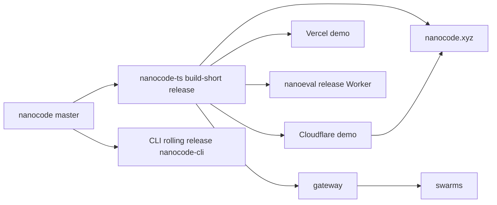

# Release chain

nanocode ships as one core that every user-facing surface runs. A release is one core build moved through every surface in dependency order, checked after each deploy, then measured build against build with nanoeval's systems suite. scripts/release-train.sh runs the chain; this file says what it does, by hand, per surface.



## Surfaces, in dependency order

| # | Surface | Repository | Pin | Deploy | URL |
|---|---------|------------|-----|--------|-----|
| 1 | Core | nanocodexyz/nanocode | master HEAD | none (source of every build) | |
| 2 | nanocode-ts build | nanocodexyz/nanocode-ts | sdk-revision.json = core sha; release build-<short> (tarball, wasm-<fingerprint>) | scripts/pin-rebuild.sh (nanocode-ts scripts/release.mjs) | github.com/nanocodexyz/nanocode-ts/releases |
| 3 | CLI | nanocodexyz/nanocode | rolling release nanocode-cli, assets suffixed with the 12-char core sha, INPUTS + SHA256SUMS | scripts/release-cli.sh build, pack, upload, publish (darwin lanes on a Mac, linux lanes in docker, windows lanes on Windows) | curl -fsSL https://nanocode.xyz/vercel/install \| sh |
| 4 | Docs site and demo front door | nanocodexyz/nanocode-site | wasm-revision.json = nanocode-ts commit (the site builds the wasm from it); binds the Cloudflare demo Worker as a service | pnpm build && wrangler deploy | https://nanocode.xyz |
| 5 | Cloudflare demo | nanocodexyz/durable-cloudflare | package.json nanocode-ts = build-<short> tarball | npm run deploy:demo (Worker nanocode-cloudflare-durable) | https://cloudflare.nanocode.xyz |
| 6 | Vercel demo | nanocodexyz/durable-vercel | package.json nanocode-ts = build-<short> tarball (public/nanocode_wasm.wasm is copied from it at build) | vercel deploy --prod (project nanocode-vercel-durable) | https://nanocode-vercel-durable.vercel.app |
| 7 | nanoeval release Worker | nanocodexyz/nanoeval | package.json nanocode-ts = build-<short> tarball; COMMIT var pin-<nanoeval short>-ncts-<short> | wrangler deploy --name nanoeval-release | https://nanoeval-release.tempo-dev.workers.dev |
| 8 | Gateway | the gateway repository (private) | package.json nanocode-ts = build-<short> tarball | its own DEPLOY.md: staging first, then production with paid calls paused and resumed | owned by the gateway team |
| 9 | swarms | gakonst/swarms | package.json nanocode-ts = build-<short> tarball; reaches agents through the gateway service binding | npm run deploy | owned by the gateway team |

Older pins name github.com/gakonst/nanocode-ts: that repository moved to nanocodexyz/nanocode-ts and the URL redirects, so the same build-<short> tarball serves both. Prefer the nanocodexyz URL when bumping.

## Bumping to a new core build

One command, from a nanocode checkout on a machine with Cloudflare and Vercel logins, gh, node, pnpm and clang 22:

```sh
scripts/release-train.sh plan          # what every surface pins now
scripts/release-train.sh train --cli   # build, CLI, site, Cloudflare demo, Vercel demo, sweep
```

Each step on its own:

1. Core build. scripts/release-train.sh build (or scripts/pin-rebuild.sh [--rev SHA] [--python-too]) pins nanocode-ts sdk-revision.json to the core sha, runs npm ci, scripts/build.mjs, npm run prepare and check:types, pushes the pin to nanocode-ts master and runs nanocode-ts scripts/release.mjs, which publishes build-<short> and wasm-<fingerprint>. Its last line is build-<short> <core sha> <fingerprint> <tarball URL>. --build-only builds without publishing.
2. CLI. Check out the core sha and run scripts/release-cli.sh build <lanes> on each lane's host, then pack and upload per host, then publish once every lane is uploaded. publish refuses a partial set and moves the nanocode-cli tag. The install scripts check SHA256SUMS.
3. Site. scripts/release-train.sh bump site <short> sets wasm-revision.json to the build's nanocode-ts commit; deploy site runs pnpm install, pnpm check:types, pnpm build (scripts/wasm.ts builds the wasm at that commit) and wrangler deploy, then pushes master.
4. Cloudflare demo. bump cf-demo <short> runs npm install <tarball URL> and commits package.json and the lock; deploy cf-demo runs npm run build, npm run dry-run (bundle in output/deploy) and npm run deploy:demo, then pushes master.
5. Vercel demo. bump vercel-demo <short>; deploy vercel-demo runs npm run check and vercel deploy --prod --scope tempoxyz --yes, then pushes master. Note the previous production deployment URL: it stays reachable for build-against-build measurement and rollback.
6. Release Worker. Only when no measurement run is using it (check the runs and ask whoever is measuring). bump release-worker <short>; NANOEVAL_RUNS_IDLE=1 scripts/release-train.sh deploy release-worker bundles with wrangler deploy --dry-run, then wrangler deploy --name nanoeval-release --var COMMIT:pin-<nanoeval short>-ncts-<short>.
7. Gateway, then swarms. Hand the build to their owners: the tarball URL, the core sha, the wasm sha256 and this file. They bump nanocode-ts to the same tarball, deploy staging, run the checks below, then production, then swarms.

The repositories behind surfaces 3 to 6 and 9 have no CI: each AGENTS.md says to build, check and deploy by hand and push to master. Every bump is one commit, chore(deps): nanocode-ts build-<short>.

## Checks after each deploy

1. Same core. scripts/release-train.sh verify <surface> <short> compares the deployed wasm's sha256 with dist/nanocode_wasm.wasm in the build-<short> tarball: the Vercel demo serves it at /nanocode_wasm.wasm, the Workers bundle it (output/deploy after the dry run), the site builds it from the pinned commit. A mismatch means the surface runs another core: stop.
2. Stock defaults. A surface runs nanocode's defaults unless an override is written down here with its reason. verify prints the Cloudflare demo's deploy vars. Known overrides to keep listed and reviewed every release: the Cloudflare demo's deploy:demo vars (CLAUDE_MODEL, OPENAI_SERVICE_TIER=priority, CHAT_PUBLIC, AI_GATEWAY_ID), the site's AI_GATEWAY_ID and request limit, and whatever the gateway's override audit lists.
3. Smoke and performance. Run nanoeval's systems suite against the surface, this build against the last:

```sh
node cli/nanoeval.ts systems run --suite systems-v1 --targets cf-demo,vercel-demo,site,release-worker,cli-local \
  --build prev=build-<previous short> --build new=build-<short>
node cli/nanoeval.ts systems compare output/systems/<previous run>/run.json output/systems/<this run>/run.json
```

systems-v1 (versioned in nanoeval-suites, preregistered in prereg/SYSTEMS-V1.md) runs, per target and concurrently: 10+ turn conversations (per-turn TTFT, decode tok/s, turn latency, drift across turns), tens of Code Mode cells per session (compute, shell, file I/O, parallel tool calls, long cells), Python cells (interpreter start, stdlib and numpy/pandas imports where supported, compute, file I/O, state across cells), cold vs warm start and session resume, and 1/10/50 concurrent sessions (aggregate tok/s, error rate), counting errors, timeouts and stalls. Its output is a timestamped run.json and summary.md: p50/p95 per metric, pass/fail per scenario, SLO pass/fail against the suite's absolute thresholds, and new/prev ratios with 95% task-clustered bootstrap intervals read as WIN, TIE or LOSS. A release ships to the next surface only when the surface passes its SLOs and has no LOSS it can't explain. scripts/release-train.sh sweep <prev> <new> runs it for every target.

The comparison is always nanocode build against nanocode build on our own surfaces. Comparisons with other agents stay in the frontier evals.

## Rollback

| Surface | Rollback |
|---------|----------|
| nanocode-ts build | Bump surfaces back to the previous build-<short> tarball; releases are never deleted. |
| CLI | Check out the previous core sha and rerun release-cli.sh publish (cached INPUTS make it a re-upload), or point users at a pinned asset name suffixed with that sha. |
| Site | wrangler rollback <version id> --name nanocode-site (ids in wrangler deployments list), then revert the bump commit. |
| Cloudflare demo | wrangler rollback <version id> --name nanocode-cloudflare-durable, then revert the bump commit. |
| Vercel demo | vercel rollback <previous deployment URL> --scope tempoxyz (or vercel promote), then revert the bump commit. |
| Release Worker | wrangler rollback <version id> --name nanoeval-release. |
| Gateway | Its DEPLOY.md rollback (wrangler rollback with paid calls paused). |
| swarms | wrangler rollback <version id> --name swarms. |

release-train.sh deploy saves each Worker's and the Vercel project's recent deployments to $TRAIN_DIR/<surface>.before before deploying, so the previous version id or URL is at hand.
