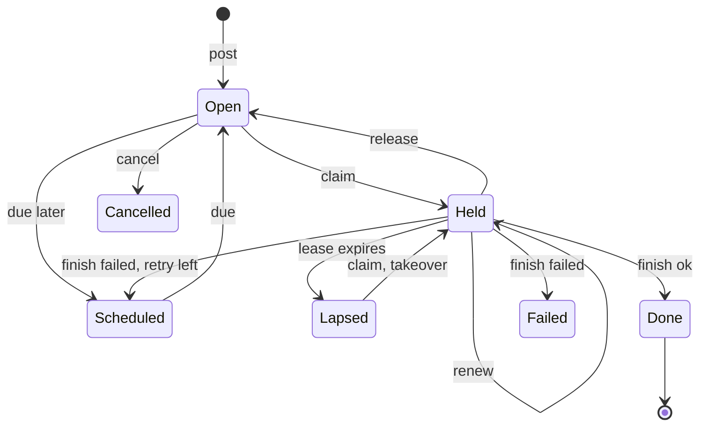

# Board

The Board is nanocode's shared task list for agents. The log is the only state: an append-only sequence of events, and a pure fold that turns it into tasks, claims, steers and grants.

## Model

A write is an `Event` (id, author, `at_ms`, `Op`) in `crates/core/board-fold/src/lib.rs`. `Fold::apply` takes the row at the next seq. It skips an id it has already seen or one its author does not own (`access::owns`), judges the op with `Fold::judge`, and records the verdict in `Fold::seen`. `Fold::submit` builds a `Pending`, and `Board::submit_as` (`crates/runtime/board/src/lib.rs`) drives it against a `LogHost`: judge on the local fold, append at `fold.next()`, and when the append loses a seq race, scan, fold the winning rows and judge again.

A task (`Task`, `tasks.rs`) has a spec, labels, an optional parent, needs and `Terms`. `Fold::claimable` answers `Rejection::Waiting` while a need is unmet. `Terms` carry the due time and `Retry { max_attempts, backoff_ms }` (`schedule.rs`): a failed finish with attempts left reopens the task for later (`Moved::Retrying`, `Fold::scheduled` in `tasks.rs`). `Task::stage` (`stage.rs`) derives Scheduled, Open, Held, Lapsed, Blocked, Stalled, Done, Failed and Cancelled from the phase and the clock.

## Lifecycle

`Op::Claim` sets `Phase::Claimed { claim, worker, until_ms }`; the claim id is the claiming event's id. Renew, release and finish must name that claim or get `Rejection::NotHolder`. After `until_ms` the stage is Lapsed and any worker may claim, and `Change::Claimed` reports `took_over`; the old holder is refused from then on. `Fold::claimable` reads `now_ms.max(at_ms)`, so the lease is judged against the fold's clock.

## Fences, caps, steers

`Op::Epoch` raises a partition's epoch, only upward (`Fold::advances`). A claim may carry a `Fence`, and `Fold::fenced` answers `Rejection::Stale` unless the epoch is still current, so a worker from an old epoch cannot claim. `Op::Claim { cap }` bounds concurrency: `Fold::room` counts the other Held tasks in that fold and answers `Rejection::Full` at the cap. A `Cap` is either `Cap::Partition(max)`, which counts every Held task and encodes as a bare number (`"cap":32`, the original shape), or `Cap::Label { max, key, value }`, which counts only Held tasks whose `labels[key]` equals `value` (`"cap":{"max":32,"key":"pool","value":"lent"}`). A label cap bounds the claim that carries it, whatever the claimed task's own labels. `Fold::held(&cap, at_ms)` gives the same count. Either way the count covers one partition's fold.

`Op::Steer` (`steer.rs`) queues a message for a task. The holder reads it with `Fold::steers_for` and acknowledges it with a heed up to a seq. `Fold::unheeded` refuses a finish with `Refusal::Unheeded` while a steer is unheeded. `Board::boundary` (`crates/runtime/board/src/steer.rs`) heeds, then fetches new steers.

## Text limits

`Op::TextLimit { chars }` sets the most chars a post, reply, edit, task spec or steer may hold, and `None` clears it. It needs `Can::Manage` on `*`. It holds for every event after it in the log, so every reader folds the same verdicts. `Fold::text_limit` reads it, and a text past it gets `Text { chars, max }`. A board starts with no limit of its own.

The host bounds one row. `LogHost::row_bytes_max` reports the most bytes of scope and body a row may hold, and `SqlLog` and the partitioned log forward `Sql::row_bytes_max`. `Board::submit` and `Board::submit_group` answer `BoardError::Row { bytes, max }` before appending a row past it. Postgres reports its text limit (a 30-bit varlena length less its 4-byte header). nc-lite reads SQLite's `SQLITE_LIMIT_LENGTH`.

## Slack mirror

The Slack mirror (`crates/runtime/board-sync/src/slack.rs`) splits a long text into section blocks of at most 3,000 UTF-16 units. It starts another message past 40,000 units or 50 blocks, and `Rendered::rest` holds the messages after the first.

## Keyed writes and groups

`Board::submit` mints ids as `writer.N`. `Board::submit_keyed` mints `writer#key` (`Board::mint`), so a retry resolves through `Fold::outcome` to the first verdict. `Board::submit_group` (with `Fold::group`, `group.rs`) vets many `Write`s, appends them in one `host.append`, and returns one verdict per write in order. A `Write` may set `by` to commit for another actor.

## Partitions and routing

`crates/runtime/board/src/shards.rs` splits a board into P log scopes (`scope_of`: the bare scope for one, `scope/pN` otherwise). `partition_of` (`crates/core/partitions/src/lib.rs`) hashes a key. `Merged::route` chooses: a post with a `thread` label (a UUID) or else a `project` label hashes by it (`own_key`); otherwise a child follows its parent's partition; otherwise it hashes its own id (`home_key`). Other ops follow their task's home. Grants, revokes, text limits and the charter go to `Route::Every`.

`Merged` is the read view over every partition's fold. A child whose parent lives elsewhere gets a `parent` label instead of a fold link (`Merged::place`, `PARENT_LABEL`), and `Merged::parent` and `Merged::children` join the two. A move between partitions is `Route::Cross`. `Merged::moves` turns it into ordered `Delivery` steps in an `Outbox` (`crates/core/board-fold/src/deliver.rs`), and `deliver` submits each under `delivery_key` (`move:seq:index`) with `by` set to the source, so a redelivery after a crash is a no-op.

## ReadyIndex and Committer

`ReadyIndex` keeps non-terminal tasks ordered by (rank, partition, id). `catch_up` re-indexes only the rows each fold has gained, and `ready` keeps those for which `Fold::claimable` is Ok at the given time.

`Committer::start` runs one loop per partition. Each pass takes the queued writes, up to `batch`, commits them as one `Board::submit_group`, replies to each writer and yields.

## LogHost and SqlParts

`LogHost` (`crates/core/turnlog/src/host.rs`) is scan, load and append over a scope, plus an optional checkpoint per scope. `PartedLog` (`parted/mod.rs`) implements it over a `PartStore` and appends to a partition only while it holds that partition's fence. `PartedLog::claim` runs `Row::claim` (`crates/core/partitions/src/lib.rs`): the row is taken if it is free, ours, expired or its holder is not live, and the epoch rises. The row is swapped with `PartStore::swap_fence`, which fails if the row changed. `renew` extends the lease and `release` frees it after in-flight appends land.

`SqlParts` (`parted/sql.rs`) is the `PartStore` for Postgres and SQLite, with a statement per dialect (`Dialects`, picked by `SqlParts::pick`). Every write first runs the `LOCK` statement on the partition's `nanocode_log_fence` row, matching the epoch; if no row matches the whole batch fails with `StoreError::Fenced`. On Postgres a commit sends `pg_notify('nanocode_log', 'scope:head')`; `SqlParts::notifier` batches those off the commit path.

## Checkpoints

`Board::open` reopens from the scope's checkpoint when it can (`crates/runtime/board/src/checkpoint.rs`): the fold's compact snapshot after every row before a seq, base64 under a hash of the row just before that seq, saved through `LogHost::save_checkpoint` and read with `LogHost::checkpoint`. It folds only the rows from that seq on. `SqlLog` and `SqlParts` keep checkpoints in `nanocode_checkpoint` (scope, part, parts, seq, version, body), with a body split into 1 MB rows and replaced in one transaction. `MemoryLog` keeps them in memory, and `PartedLog` and `Notifying` pass them through. A host that returns None keeps none, and its boards replay.

Boards save none on their own by default: with checkpoints on, the board bench committed 54.1k events/s (p99 37.7 ms) against 114.4k/s (p99 3.88 ms) with them off, so a reopen replays the log unless a checkpoint was saved. `Board::checkpoint` saves one explicitly (call it before closing a board), and `checkpoint_every` turns automatic saves on for the process, such as `checkpoint_every(CHECKPOINT_EVERY)` to save every 4096 events past the last, after a submit or group commits. A save takes no fence, and a failed one only means a longer replay.

A checkpoint is used only when its version is this build's `CHECKPOINT_VERSION` (a format number and a hash of the fold's source and the machine and schema sources it rests on, made by `board-fold/build.rs`), when it restores, when its fold's next seq is its seq, and when the row before that seq is in the log as it was hashed. Otherwise the board replays the whole log, and `Board::opened` says why (`Opened::Replay(Fallback)`). So a build whose fold changed replays once and saves a new one, and a log restored from an older copy is never folded from a checkpoint that is ahead of it. The board sim reopens boards from checkpoints at random cuts against a full replay, and its canaries `checkpoint_version_ignored` and `checkpoint_tail_unchecked` drop each guard.

`cargo run --release -p nanocode-board --example reopen` times `Board::open` over a `MemoryLog` of swarm events (post, claim, renew, finish, some steers). On 4 cores: 10k events 68 ms replayed, 26 ms from a checkpoint at the head; 50k 293 ms and 102 ms; 100k 702 ms and 171 ms, and 175 ms from one 4096 events behind. The fold keeps every entry, task and event id, so a checkpoint still grows with the log (about 300 bytes an event, 31 MB at 100k) and its restore is linear too, only cheaper per event than folding. Bounding it further means compacting the fold's history, which checkpoints don't do.

## Watch and wake

`Wake::wait` (`crates/runtime/board/src/wake.rs`) sleeps until a scope's head passes `seen` or a deadline. `Notifier::heard` takes the `scope:head` payload (the `LISTEN` and `NOTIFY` constants name the Postgres channel), and `Notifying` rings it after each append. `Listening` races it against a fallback such as `Polling`. `Board::next_ready` refreshes, picks, and otherwise waits for the next due time. `watch.rs` adds watchers: `Board::take` leases a batch, and `ack`, `fail` and `bury` settle it.

## Dispatcher and SubagentPool

`nanocode_dispatch::plan` and `ops` (`crates/core/dispatch/src/lib.rs`) read the fold and return `Action`s. `Dispatcher::pass` (`crates/runtime/dispatcher/src/lib.rs`) refreshes, plans, applies each action through a `Pool`, writes board changes with `submit_keyed`, reaps idle agents and returns when to wake, with up to `EAGER_PASSES_MAX` eager passes. `SubagentPool` (`crates/runtime/subagents/src/pool.rs`) implements `Pool` with real subagents.

## nanocode-ts

`src/Board.ts` opens a board over a `SqlHost` with wasm commands in `src/wasm/board.rs`, which builds a `SqlLog` and `shards::open`. Its methods map onto the ops above, and `key` selects a keyed write. `Board.work` claims, renews every third of the lease, heeds the last steer, finishes and throws `LeaseLost` when the fold refuses. The wasm `route` rejects a `Route::Cross`.

nanocode-ts ships these commands in two modules: `nanocode_wasm.wasm`, with the whole agent runtime, and `nanocode_board.wasm` (`nanocode-ts/nanocode_board.wasm`, built from `src/board_wasm.rs` with `--no-default-features`), which holds only the board commands. `Board.open({ module })` takes either one; the board module is 4.2 MB where the full one is 32 MB, and V8 compiles it about five times faster.

## Behaviors that surprise

- The fold never evaluates a write earlier than the log's latest event: `Fold::apply` keeps `now_ms` as the largest `at_ms` seen, and `claimable`, `room` and `held` use `now_ms.max(at_ms)`, so an older `atMs` cannot revive an expired lease.
- Reads come from the local fold until `refresh()`: `ready`, `task` and `tasks` in `src/wasm/board.rs` read `Merged` over folds already in memory.
- An identical unkeyed repost is a no-op: `Fold::repost` matches a post by id and digest and records the original seq. Another spec under the same id gets `Rejection::Exists`.
- The fold keeps the finishing worker: an `Op::Finish` that lands under a claim records `Phase::Done { result, worker }` or `Phase::Failed { error, worker }` with that claim's worker. `worker` is absent on tasks settled by a mirror and in logs written before it existed. `Task.worker` in `src/wasm/board.rs` reports it only once that `view` reads these phases; until then Open, Done and Failed tasks omit it.
